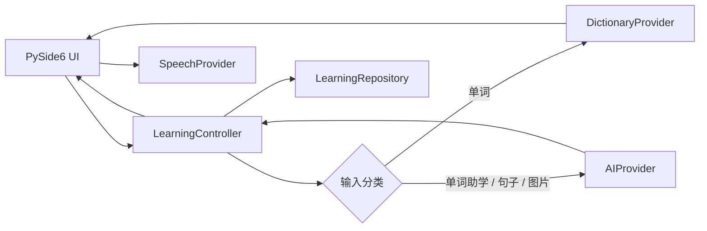

# 架构说明

## 查询链路

单词链路故意采用渐进呈现：本地数据库结果先发出，网络结果之后补全。同一次 AI 请求支持真实取消，并记录首字节和总耗时。缓存键包含模型、提示版本、语言、上下文和词典事实，避免不同设置之间串缓存。

## 模块边界

- `domain/`：不依赖 UI 的语言中立数据模型。
- `services/`：词典、AI、语音、选区读取等可替换适配器。
- `storage/`：缓存、历史、收藏、指标的 SQLite 仓储。
- `controller.py`：唯一的用例编排层。
- `ui/`：只渲染结构化状态，不直接访问网络或数据库。
- `application.py`：唯一的具体依赖组装位置。

未来增加日语、法语等语言时，应新增 `DictionaryProvider` 或语言包，并扩充 `LanguageProfile` 配置；不需要改动主窗口的查询流程。云端 TTS、离线 TTS 也遵循同一 `SpeechProvider` 边界。
