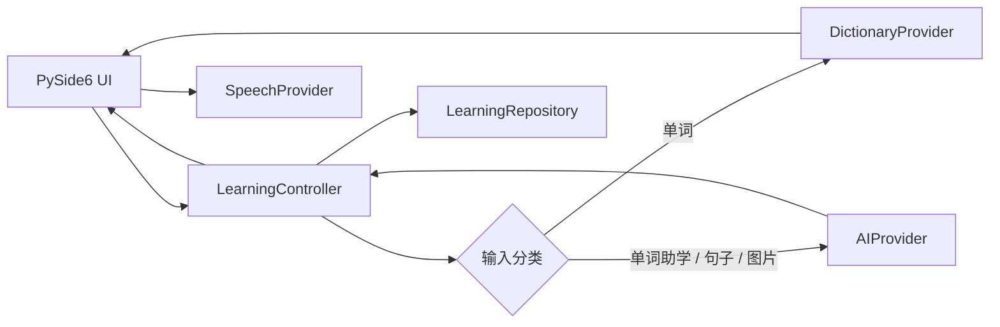
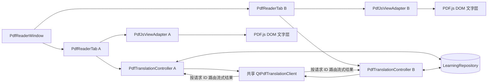

# 架构说明

## 查询链路

单词链路故意采用渐进呈现：本地数据库结果先发出，网络结果之后补全。同一次 AI 请求支持真实取消，并记录首字节和总耗时。缓存键包含模型、提示版本、语言、上下文和词典事实，避免不同设置之间串缓存。

## PDF 精读链路

`PdfReaderWindow` 只管理全局工具栏、文档标签、空状态、最大化和专注阅读。每个 `PdfReaderTab` 独立持有一个视图、译文面板和控制器，因此切换标签不需要手工序列化 UI 状态。所有控制器共享一个并发网络客户端，通过请求 ID 隔离结果；关闭标签只取消自身请求并释放自身 PDF 文档。

PDF 视图只负责连续渲染、DOM 原生文字选择和标记叠加。每个标签拥有独立的 `QWebEngineView`、WebChannel 桥和仅绑定 `127.0.0.1` 的随机端口资源服务；服务只暴露固定 PDF.js 资源与该标签当前文档，并支持 Range 流式读取。PDF.js 的页面、文字层和蓝色选区共享浏览器布局，Python 不再重建当前选区坐标。释放鼠标后，桥接层才把规范化文字、页码、字符范围和页面坐标转换为 `PdfTextSelection`。控制器负责选区状态、取消、缓存、指标与标记编排；客户端使用一次流式请求先输出译文，再解析 `<<<PHRASES>>>` 后最多 5 个词组。切换选区会取消旧请求并忽略迟到结果。缓存命中时不访问网络。

PDF 标记以文档指纹、页码和文字范围为唯一键存入 SQLite。文档指纹来自规范化路径、文件大小和修改时间；路径仅在本地参与计算。网络请求只包含规范化选区和源/目标语言，不包含 PDF 路径、全文或标记。

## 模块边界

- `domain/`：不依赖 UI 的语言中立数据模型。
- `services/`：词典、AI、语音、选区读取等可替换适配器。
- `storage/`：缓存、历史、收藏、指标的 SQLite 仓储。
- `controller.py`：便捷模式的查询编排层。
- `pdf_controller.py`：单个 PDF 标签的选区翻译、缓存、请求生命周期与标记编排层。
- `ui/pdf_reader_tab.py`：一个 PDF 文档的完整阅读会话，并在创建标签时才懒加载 WebEngine。
- `ui/pdfjs_view.py`、`ui/pdfjs_bridge.py`、`ui/pdfjs_server.py`：PDF.js 显示适配、受验证的 DOM 边界与本机流式资源服务。
- `ui/pdf_reader_window.py`：多文档标签与全局阅读窗口状态。
- `ui/` 其他模块：只渲染结构化状态，不直接访问网络或数据库。
- `application.py`：唯一的具体依赖组装位置，并按需创建便捷/PDF 模式窗口。

未来增加日语、法语等语言时，应新增 `DictionaryProvider` 或语言包，并扩充 `LanguageProfile` 配置；不需要改动主窗口的查询流程。云端 TTS、离线 TTS 也遵循同一 `SpeechProvider` 边界。

PDF.js 只读取 PDF 自带文字层。OCR、批量翻译和笔记系统不在当前边界内；跨页选区可用于翻译，但不会保存为单页标记。WebEngine 在创建 PDF 标签前不会导入，避免便捷模式冷启动承担 Chromium 成本。
