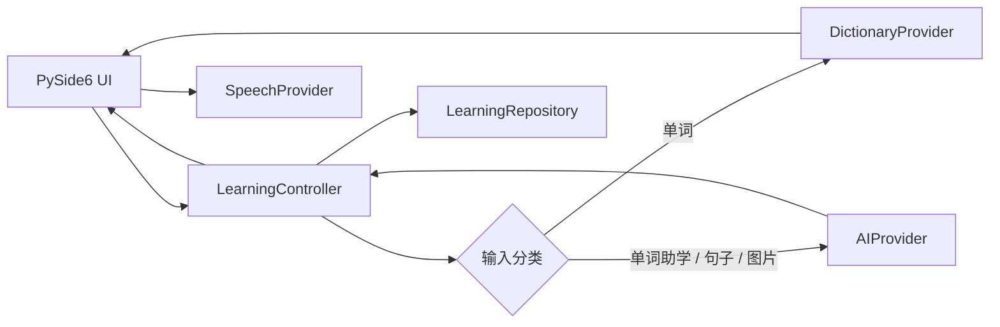
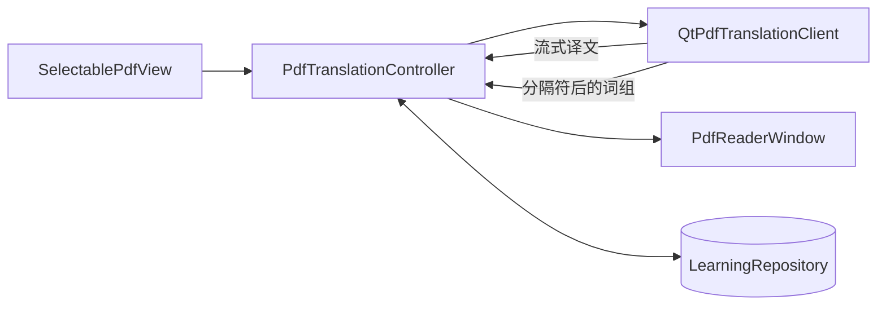

# 架构说明

## 查询链路

单词链路故意采用渐进呈现：本地数据库结果先发出，网络结果之后补全。同一次 AI 请求支持真实取消，并记录首字节和总耗时。缓存键包含模型、提示版本、语言、上下文和词典事实，避免不同设置之间串缓存。

## PDF 精读链路

PDF 视图只负责连续渲染、页内文字选择和标记叠加；控制器负责选区状态、取消、缓存、指标与标记编排；独立客户端使用一次流式请求先输出译文，再解析 `<<<PHRASES>>>` 后最多 5 个词组。切换选区会取消旧请求并忽略迟到结果。缓存命中时不访问网络。

PDF 标记以文档指纹、页码和文字范围为唯一键存入 SQLite。文档指纹来自规范化路径、文件大小和修改时间；路径仅在本地参与计算。网络请求只包含规范化选区和源/目标语言，不包含 PDF 路径、全文或标记。

## 模块边界

- `domain/`：不依赖 UI 的语言中立数据模型。
- `services/`：词典、AI、语音、选区读取等可替换适配器。
- `storage/`：缓存、历史、收藏、指标的 SQLite 仓储。
- `controller.py`：便捷模式的查询编排层。
- `pdf_controller.py`：PDF 选区翻译、缓存与标记编排层。
- `ui/`：只渲染结构化状态，不直接访问网络或数据库。
- `application.py`：唯一的具体依赖组装位置，并按需创建便捷/PDF 模式窗口。

未来增加日语、法语等语言时，应新增 `DictionaryProvider` 或语言包，并扩充 `LanguageProfile` 配置；不需要改动主窗口的查询流程。云端 TTS、离线 TTS 也遵循同一 `SpeechProvider` 边界。

`QtPdf` 只读取 PDF 自带文字层。OCR、跨页选区、批量翻译和笔记系统不在当前边界内，避免把阅读模式扩成高延迟、难维护的编辑器。
